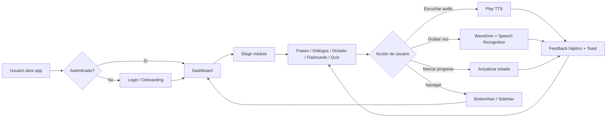
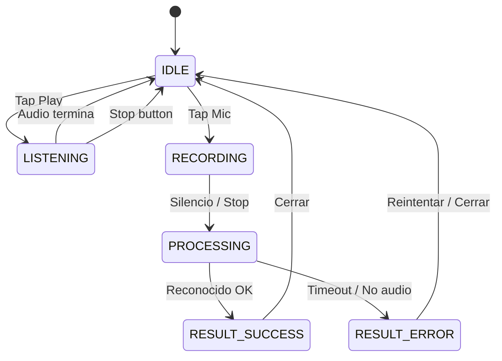
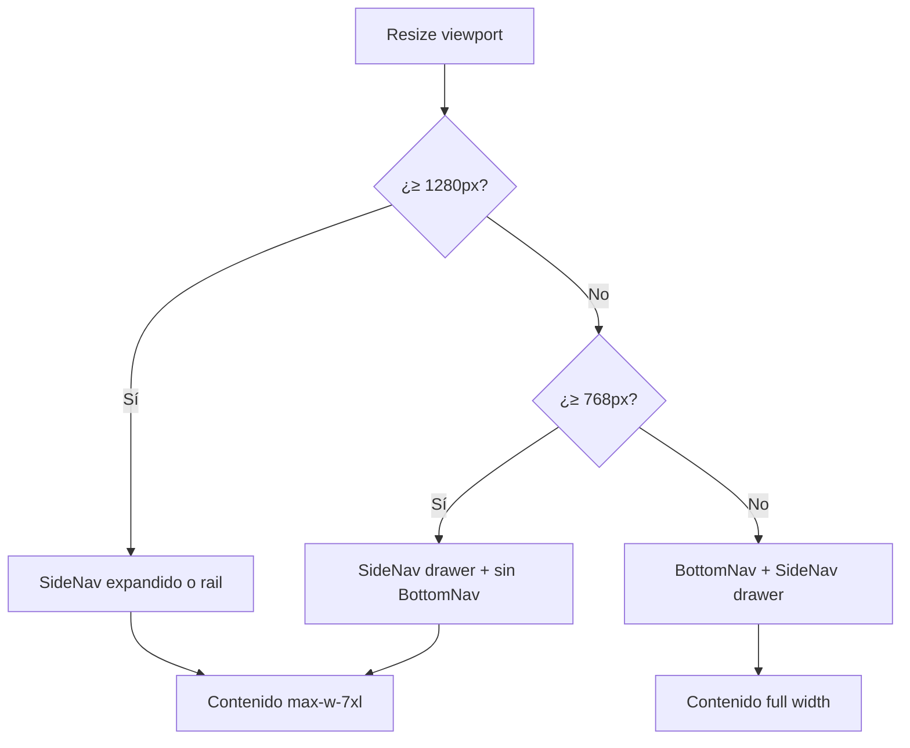

# Sistema de Diseño y Experiencia de Usuario — HostelEnglish PWA 2026
**Versión:** 1.0.0 — F1 Discovery  
**Autor:** Michel Macias (UX)  
**Fecha:** Noviembre 2026  
**Estado:** Especificación aprobada para implementación

---

## 1. Diagnóstico UX Actual

### 1.1 Estado del arte hoy

| Área | Hallazgo | Severidad |
|------|----------|-----------|
| Desktop layout | Escala forzada al 80% vía media query; aprovechamiento pobre de ancho | 🔴 Alta |
| Navegación | BottomNav móvil correcto; SideNav desktop sin estado colapsado/overlay limpio | 🟡 Media |
| Touch targets | Algunos botones caen bajo 48x48px en cards densas | 🟡 Media |
| Hidratación standalone | Problemas previos reportados; aún sin mitigar con `suppressHydrationWarning` + frame buster | 🔴 Alta |
| Feedback háptico | Solo tres niveles (light/medium/heavy) sin mapeo a eventos de dominio | 🟡 Media |
| Audio/visualización | Botón de play sin feedback visual continuo; sin waveform | 🟡 Media |
| Modo oscuro/claro | `color-scheme: light dark` declarado pero sin tokens light mode funcionales | 🔴 Alta |
| Tipografía | Inter funciona, pero sin escala adaptativa por condiciones de luz | 🟡 Media |
| Accesibilidad | `focus-visible` y ARIA presentes, pero sin skip-link ni landmarks completos | 🟢 Baja |

### 1.2 Problemas arquitectónicos

- **Tokens hardcodeados en múltiples capas:** Tailwind config + `:root` CSS + componentes inline. Un cambio requiere 3 archivos.
- **Glassmorphism inconsistente:** Algunas cards usan `bg-white/10` sin `backdrop-blur` uniforme.
- **Framer Motion disperso:** Animaciones inline en páginas, sin choreografía coordinada ni reduced-motion.
- **Sin estrategia de spacing:** Border radius van de `rounded-2xl` a `rounded-[3rem]` sin sistema.

---

## 2. Sistema de Diseño 2026 — Visión

### 2.1 Principios rectores

```
1. NATIVE FIRST — Se siente app, no web.
2. LIGHT AWARE — Se adapta al entorno (luz ambiental).
3. TOUCH FIRST — 48x48px mínimo, 56x56px preferido.
4. GLASS SUBTLE — Profundidad por luz, no por sombras duras.
5. MOTION WITH PURPOSE — Cada animación comunica estado.
6. ACCESSIBLE BY DEFAULT — WCAG AAA en modo oscuro, AA en light.
7. TOKENS SINGLE SOURCE — Un archivo, una verdad.
```

### 2.2 Estrategia de theming

```
+-------------------+     +------------------+
|   Theme Engine    |---->|  CSS Variables   |
| (auto + manual)   |     |  :root / .light  |
+-------------------+     +------------------+
         |                        |
         v                        v
+-------------------+     +------------------+
| Tailwind v4       |     |  Runtime Switch  |
| @theme directive  |     |  (prefs + sensor)|
+-------------------+     +------------------+
         |                        |
         +--------+   +----------+
                  v   v
             Components (sin lógica de tema)
```

**Modos:**
- `dark` — Predeterminado. Fondo profundo `#0f1419`, superficie `#1a2332`.
- `light` — Opcional, activable. Fondo `#f5f7fa`, superficie `#ffffff`.
- `auto` — Sigue `prefers-color-scheme` + sensor de luz ambiental (si disponible).

**Regla de contraste WCAG AAA (dark):**
- Texto normal: ratio ≥ 7:1
- Texto grande (≥18px bold): ratio ≥ 4.5:1
- Elementos interactivos: contorno/foco ≥ 3:1 contra fondo adyacente

---

## 3. Tokens de Diseño

### 3.1 Espacio de color semántico (Dark — predeterminado)

```css
:root, [data-theme="dark"] {
  /* === FONDOS === */
  --bg-base:        #0f1419;       /* Fondo raíz / body */
  --bg-surface:     #1a2332;       /* Cards, sheets, panels */
  --bg-elevated:    #243044;       /* Modals, dropdowns, popovers */
  --bg-hover:       rgba(255,255,255,0.06);
  --bg-pressed:     rgba(255,255,255,0.10);

  /* === BORDES === */
  --border-subtle:  rgba(255,255,255,0.06);
  --border-default: rgba(255,255,255,0.12);
  --border-focus:   rgba(255,255,255,0.25);

  /* === TEXTO === */
  --text-primary:   #f0f4f8;       /* Lectura principal — AAA sobre bg-base */
  --text-secondary: #94a3b8;       /* Subtítulos, metadatos */
  --text-tertiary:  #64748b;       /* Timestamps, badges inactivos */
  --text-disabled:  #475569;
  --text-on-accent: #ffffff;

  /* === MARCA === */
  --accent:         #e67e22;       /* Warm orange — identidad HostelEnglish */
  --accent-soft:    rgba(230,126,34,0.15);
  --accent-hover:   #f59e0b;
  --accent-glow:    rgba(230,126,34,0.35);
  --accent-hsl:     28 80% 52%;

  /* === SEMÁNTICOS === */
  --success:        #10b981;
  --success-soft:   rgba(16,185,129,0.15);
  --warning:        #f59e0b;
  --warning-soft:   rgba(245,158,11,0.15);
  --error:          #ef4444;
  --error-soft:     rgba(239,68,68,0.15);
  --info:           #3b82f6;
  --info-soft:      rgba(59,130,246,0.15);

  /* === AUDIO === */
  --waveform-idle:  rgba(255,255,255,0.2);
  --waveform-active:var(--accent);
  --waveform-user:  #3b82f6;

  /* === SOMBRAS === */
  --shadow-sm:      0 1px 2px rgba(0,0,0,0.3);
  --shadow-md:      0 4px 12px rgba(0,0,0,0.4);
  --shadow-lg:      0 12px 40px rgba(0,0,0,0.5);
  --shadow-glow:    0 0 30px var(--accent-glow);

  /* === BLUR === */
  --blur-sm:        8px;
  --blur-md:        16px;
  --blur-lg:        24px;

  /* === TIPOGRAFÍA === */
  --font-sans:      'Inter', system-ui, -apple-system, BlinkMacSystemFont, sans-serif;
  --font-mono:      'JetBrains Mono', 'Fira Code', monospace;
  --font-display:   'Inter', system-ui, sans-serif;

  /* === ESCALA DE TIPOGRAFÍA === */
  --text-xs:        0.75rem;    /* 12px — labels */
  --text-sm:        0.875rem;   /* 14px — body small */
  --text-base:      1rem;       /* 16px — body */
  --text-lg:        1.125rem;   /* 18px */
  --text-xl:        1.25rem;    /* 20px */
  --text-2xl:       1.5rem;     /* 24px */
  --text-3xl:       1.875rem;   /* 30px */
  --text-4xl:       2.25rem;    /* 36px */
  --text-5xl:       3rem;       /* 48px — hero */

  --leading-tight:  1.15;
  --leading-normal: 1.5;
  --leading-relaxed:1.7;

  /* === ESPACIADO === */
  --space-1: 0.25rem;   /* 4px */
  --space-2: 0.5rem;    /* 8px */
  --space-3: 0.75rem;   /* 12px */
  --space-4: 1rem;      /* 16px */
  --space-5: 1.25rem;   /* 20px */
  --space-6: 1.5rem;    /* 24px */
  --space-8: 2rem;      /* 32px */
  --space-10: 2.5rem;   /* 40px */
  --space-12: 3rem;     /* 48px */
  --space-16: 4rem;     /* 64px */
  --space-20: 5rem;     /* 80px */

  /* === RADIUS === */
  --radius-sm:      0.75rem;   /* 12px */
  --radius-md:      1.25rem;   /* 20px */
  --radius-lg:      1.75rem;   /* 28px */
  --radius-xl:      2.5rem;    /* 40px */
  --radius-full:    9999px;

  /* === DURACIONES === */
  --ease-out:       cubic-bezier(0.22, 1, 0.36, 1);
  --ease-spring:    cubic-bezier(0.34, 1.56, 0.64, 1);
  --duration-fast:  150ms;
  --duration-base:  300ms;
  --duration-slow:  500ms;
  --duration-slower:800ms;
}
```

### 3.2 Modo Light

```css
[data-theme="light"] {
  --bg-base:        #f5f7fa;
  --bg-surface:     #ffffff;
  --bg-elevated:    #ffffff;
  --bg-hover:       rgba(0,0,0,0.04);
  --bg-pressed:     rgba(0,0,0,0.08);

  --border-subtle:  rgba(0,0,0,0.06);
  --border-default: rgba(0,0,0,0.12);
  --border-focus:   rgba(0,0,0,0.25);

  --text-primary:   #0f172a;   /* AAA sobre bg-surface */
  --text-secondary: #475569;
  --text-tertiary:  #94a3b8;
  --text-disabled:  #cbd5e1;

  --shadow-sm:      0 1px 2px rgba(0,0,0,0.05);
  --shadow-md:      0 4px 12px rgba(0,0,0,0.08);
  --shadow-lg:      0 12px 40px rgba(0,0,0,0.12);
}
```

### 3.3 Variables de entorno adaptativas (env/media)

```css
/* Hora del día: ajuste sutil automático */
@media (prefers-color-scheme: dark) { /* hereda tokens dark */ }

/* Entorno de alta luminosidad */
@media (prefers-contrast: more) {
  :root {
    --border-default: rgba(255,255,255,0.25);
    --text-secondary: #e2e8f0;
  }
}

/* Movimiento reducido */
@media (prefers-reduced-motion: reduce) {
  :root {
    --duration-fast: 1ms;
    --duration-base: 1ms;
    --duration-slow: 1ms;
    --duration-slower: 1ms;
  }
}
```

---

## 4. Tipografía Adaptativa

### 4.1 Escalas por dispositivo

```
MÓVIL (320-480px):   base 15px, leading 1.5
TABLET (481-1024px): base 16px, leading 1.55
DESKTOP (>1024px):   base 16px, leading 1.5
TV/GRANDE (>1920px): base 17px, leading 1.55
```

### 4.2 Ajuste por luminosidad (experimental)

```css
/* Cuando el sensor de luz reporta > 10,000 lux (exterior soleado) */
@media (environment-lightness: bright) {
  :root {
    --text-primary:   #1a1a2e;  /* más oscuro que el default light */
    --text-secondary: #374151;
  }
}
```

> **Nota:** `environment-lightness` es un API emergente. Fallback: usar `prefers-contrast: more`.

### 4.3 Jerarquía tipográfica

| Token | Tamaño | Peso | Uso |
|-------|--------|------|-----|
| `text-5xl` | 48px | 800/900 | Hero, títulos de pantalla |
| `text-4xl` | 36px | 800 | H1 página |
| `text-3xl` | 30px | 700 | H2 sección |
| `text-2xl` | 24px | 700 | H3 bloque, card titles |
| `text-xl`  | 20px | 600 | Subtítulos, label fuerte |
| `text-base` | 16px | 400 | Body principal |
| `text-sm`  | 14px | 400 | Body secundario |
| `text-xs`  | 12px | 500 | Labels, badges, timestamps |

**Regla:** Nunca usar font-weight menor a 400 en texto interactivo.

---

## 5. Patrones de Navegación y Touch

### 5.1 Arquitectura de navegación por contexto

```
+------------------------------------------+
|                 APP SHELL                 |
|  +------------------------------------+  |
|  | TopBar (desktop sticky)            |  |
|  +------------------------------------+  |
|  |                                    |  |
|  |  CONTENT AREA                      |  |
|  |  (padding adaptativo)              |  |
|  |                                    |  |
|  +------------------------------------+  |
|  | BottomNav (mobile < sm)            |  |
|  | SideNav drawer (tablet/desktop)    |  |
|  +------------------------------------+  |
+------------------------------------------+
```

### 5.2 Navegación por gestos (PWA)

| Gesto | Acción | Ámbito |
|-------|--------|--------|
| Swipe left (edge 20px) | Volver / back | Cualquier nivel >1 |
| Swipe down (pull) | Pull-to-refresh | Listas (Frases, Progreso) |
| Swipe up (sheet) | Cerrar bottom sheet | Bottom sheets |
| Tap (long) | Context menu | PhraseCard, Flashcard |
| Two-finger swipe | Scroll horizontal | Flashcards en carrusel |

**Implementación:**
- Usar `@use-gesture/react` para normalizar eventos cross-browser.
- Prevenir `overscroll-behavior: none` en body para eliminar rebote web.
- Touch target mínimo: **56x56px** preferido, **48x48px** mínimo aceptable.

### 5.3 Bottom Navigation (mobile)

```
SPEC:
- Fixed bottom, z-50
- bg-base/95 + backdrop-blur-lg
- border-top: 1px var(--border-subtle)
- Altura: 64px + safe-area-inset-bottom
- Items: 5 máximo
- Icono: 24px, label: 10px uppercase tracking-widest
- Active: icono accent, scale 1.1, drop-shadow accent glow
- Inactive: text-tertiary
- Tap feedback: active:scale-90 (150ms)
```

### 5.4 Side Navigation (tablet/desktop)

```
SPEC:
- Drawer: w-72 (288px)
- Colapsada: w-20 (icon-only rail)
- Estado colapsado por defecto en < 1280px (drawer)
- Estado expandido por defecto en ≥ 1280px
- Overlay backdrop: bg-black/40 backdrop-blur-sm (solo drawer abierto)
- Transición: 300ms ease-in-out
- Header: logo + botón cerrar (solo expandido)
- Footer: selector idioma + versión (solo expandido)
```

### 5.5 Top Navigation (desktop)

```
SPEC:
- Sticky top, h-16
- bg-base/80 + backdrop-blur-lg + border-b border-subtle
- Izquierda: botón toggle side nav + logo mark
- Derecha: botón tema + avatar/usuario
- Elevación en scroll: shadow-md tras 8px de scroll
```

---

## 6. Componentes del Sistema de Diseño

### 6.1 Botones

```
PRIMARY
  bg: accent
  text: text-on-accent (white)
  py: 4 (16px) px: 8 (32px)
  radius: radius-lg
  font-weight: 700
  shadow: shadow-glow
  hover: brightness(1.1) + shadow-lg
  active: scale(0.95)
  focus: 2px outline accent offset-2

SECONDARY
  bg: bg-hover
  text: text-primary
  border: border-default
  hover: bg-pressed + border-focus

GHOST
  bg: transparent
  text: text-secondary
  hover: bg-hover + text-primary

ICON BUTTON
  min-size: 48x48px
  radius: radius-md
  flex center icon
```

### 6.2 Cards y Sheets

```
CARDS (PhraseCard, Flashcard, DashboardModule)
  bg: bg-surface
  border: border-default (1px)
  radius: radius-xl
  padding: space-6
  shadow: shadow-md
  hover: border-border-focus + translateY(-2px)

ELEVATED SHEETS (BottomSheet, Modal)
  bg: bg-elevated
  radius: radius-xl (top corners)
  shadow: shadow-lg
  backdrop-filter: blur(blur-lg)
  handle-bar: 40x4px, rounded-full, bg-border-default
```

### 6.3 Inputs y controles

```
INPUT BASE
  bg: bg-elevated
  border: border-default
  radius: radius-md
  padding: 12px 16px
  text: text-primary
  placeholder: text-tertiary
  focus: border-accent + ring-2 ring-accent/30

SELECT / DROPDOWN
  Mismo que input + chevron right
  Opciones: bg-elevated hover:bg-hover

TOGGLE / SWITCH
  48x28px track, radius-full
  On: bg-accent, knob bg-white
  Off: bg-border-default, knob bg-text-tertiary
```

### 6.4 Badges y Tags

```
STATUS BADGE
  padding: 4px 12px
  radius: radius-full
  font-size: 10px
  font-weight: 600
  uppercase tracking-widest

  Pendiente: bg-hover text-secondary border-border-subtle
  Estudiada: bg-success-soft text-success border-success/30
  Aprendida: bg-accent-soft text-accent border-accent/30
  Error:     bg-error-soft text-error border-error/30
```

### 6.5 Toasts y Notificaciones

```
TOAST CONTAINER
  Position: fixed bottom-24 left-1/2 -translate-x-1/2
  z-index: 60
  Max-width: 400px

TOAST ITEM
  bg: bg-elevated/95
  border: border-default
  radius: radius-lg
  padding: 16px 20px
  backdrop-blur-lg
  shadow-lg
  animation: slideInBottom (300ms var(--ease-out))
  exit: slideOutBottom (250ms ease-in)

  Icon: 24px, color por tipo
  Text: text-sm font-semibold text-primary
  Close: icon-button 32x32px
```

### 6.6 Skeleton Loading

```
SKELETON
  bg: linear-gradient shimmer
  from: rgba(255,255,255,0.03)
  via: rgba(255,255,255,0.08)
  to: rgba(255,255,255,0.03)
  animation: shimmer 1.5s infinite
  radius: radius-md
```

### 6.7 Flashcard 3D

```
CONTAINER
  width: 100%, height: 400px (mobile) / 500px (desktop)
  perspective: 1000px

INNER
  relative w-full h-full
  transition: transform 600ms var(--ease-spring)
  transform-style: preserve-3d

FACE (front/back)
  absolute inset-0
  backface-visibility: hidden
  radius: radius-xl
  bg: bg-surface
  border: border-default
  shadow-lg
  padding: 32px

BACK
  rotateY(180deg)
```

### 6.8 Audio Waveform Component (NUEVO)

```
WAVEFORM CONTAINER
  height: 64px
  display: flex align-items: center gap: 2px

WAVEFORM BAR
  width: 3px
  radius: radius-full
  bg: waveform-idle (default) | waveform-active (playing) | waveform-user (recording)
  height: animado por frecuencia de audio
  transition: height 80ms linear

IDLE STATE
  Todas barras: 8px altura, opacidad 0.3, animación sutil idle-pulse

LISTENING STATE
  Barras: altura dinámica desde AnalyserNode (fftSize 256)
  Color: accent, glow sutil

RECORDING STATE
  Barras: altura dinámica, color info (#3b82f6)
  Pulso central más marcado
```

### 6.9 Bottom Sheet (NUEVO)

```
SHEET OVERLAY
  fixed inset-0 bg-black/40 backdrop-blur-sm z-50
  opacity 0 -> 1 (200ms)

SHEET PANEL
  fixed bottom-0 left-0 right-0
  bg: bg-elevated/98 backdrop-blur-xl
  radius: radius-xl (top)
  padding-top: 12px (handle area)
  padding-bottom: env(safe-area-inset-bottom)
  transform: translateY(100%) -> translateY(0)
  transition: transform 350ms var(--ease-spring)

SNAP POINTS
  [25%, 50%, 90%] del viewport
  Drag threshold: 20% del sheet height para dismiss
```

---

## 7. Interacciones de Voz y Audio Visual

### 7.1 Waveform en tiempo real

```
FLUJO DE DATOS:
MediaStream (mic) -> AudioContext -> AnalyserNode -> requestAnimationFrame
-> Bar heights (Uint8Array) -> state.bars[] -> render

LISTENING (reproducción TTS):
  - Usar mismo AnalyserNode pero fuente = MediaElementAudioSourceNode
  - Barras responden a la salida de audio del sistema
  - Color: accent

SPEAKING (grabación):
  - Barras responden al micrófono en vivo
  - Color: info (#3b82f6)
  - Indicador central más ancho (pulso de voz)
  - Duración máxima visual: timer MM:SS en overlay
```

### 7.2 Feedback háptico granular

```
EVENTO                     PATRÓN VIBRATE         NOTA
──────────────────────────────────────────────────────
Acierto (correct answer)   [15]                  Confirmation suave
Fallo leve (wrong answer)  [10, 30, 10]          Doble pulso
Error crítico (no audio)   [40, 20, 40]          Triple pulso largo
Racha conseguida (≥7)      [10, 50, 10, 50, 10]  Celebración rítmica
Navegación tab change      [5]                   Tick imperceptible
Pull-to-refresh            [8]                   Tactile nudge
Bottom sheet snap          [12]                  Position lock
```

### 7.3 Estados de audio UI

```
IDLE
  Waveform: flat bars 8px, color idle
  Mic button: ghost
  Play button: primary

LISTENING
  Waveform: animated bars, accent color
  Mic button: outline info
  Overlay: "Escuchando..."

PROCESSING (speech recognition)
  Waveform: circular pulse
  Overlay: "Procesando..."
  Botones: disabled

RESULT
  Waveform: brief flash (success green / error red)
  Toast: resultado de la pronunciación
```

---

## 8. Desktop & Tablet Adaptability

### 8.1 Layout responsive strategy

```
BREAKPOINTS:
  sm:  640px   (large phone landscape)
  md:  768px   (tablet portrait)
  lg: 1024px   (tablet landscape / small desktop)
  xl: 1280px   (desktop)
  2xl: 1536px  (large desktop)

MOBILE (< md)
  - BottomNav visible
  - SideNav: drawer
  - Contenido: full width, padding 16px
  - Cards: full bleed

TABLET (md - lg)
  - BottomNav: hidden
  - SideNav: drawer (toggle button visible)
  - Contenido: max-w-3xl centered
  - Cards: max-w-2xl centered

DESKTOP (≥ xl)
  - SideNav: rail colapsado (w-20) o expandido (w-72)
  - TopNav: sticky
  - Contenido: max-w-7xl (1280px)
  - Layout dual posible: study pane + stats rail (ver 8.3)
```

### 8.2 Sidebar colapsable (desktop)

```
ESTADO EXPANDIDO (≥ 1280px, default)
  width: 288px (w-72)
  Logo + nombre app
  Nav items: icono + label
  Footer: selector idioma + versión

ESTADO COLAPSADO
  width: 80px (w-20)
  Solo iconos, tooltip al hover
  Logo: solo icono "H"

TRANSICIÓN
  width 300ms ease-in-out
  Opacity labels 200ms
  Tooltips: z-index alto, delay 300ms
```

### 8.3 Vista dividida (Desktop ≥ 1280px)

```
+--sidebar--+----study-pane----+--stats-rail--+
|           |                  |              |
| icon rail | Contenido        | Mini stats   |
| or full   | principal        | Mini chart   |
| drawer    | (frases, quiz)   | Achievements |
|           |                  |              |
+-----------+------------------+--------------+

Study Pane: flex-grow, max-w-3xl
Stats Rail: w-80, fixed right, sticky top-20
```

### 8.4 Eliminación del "escala al 80%"

**Cambio propuesto:**
- Eliminar `@media (min-width: 1024px) { font-size: 85%; }`
- En su lugar: usar breakpoints naturales de Tailwind
- Contenido desktop: `max-w-7xl mx-auto` con padding lateral
- Sidebar consume el espacio; contenido fluye alrededor

---

## 9. Accesibilidad

### 9.1 Estándares objetivo

| Elemento | Estándar |
|----------|----------|
| Contraste texto normal | WCAG AAA (≥7:1) |
| Contraste texto grande | WCAG AA (≥4.5:1) |
| Touch targets | 48x48px mínimo, 56x56px preferido |
| Focus indicators | 2px solid, 2px offset, radius 4px |
| Color no único indicador | Icono + texto + color |
| Reduced motion | Todas las animaciones ≤ 1ms |
| Screen reader | ARIA labels, roles, live regions |

### 9.2 Skip link y landmarks

```tsx
// Primer foco al entrar
<a href="#main-content" className="sr-only focus:not-sr-only">
  Saltar al contenido
</a>

// Landmarks obligatorios
<header> (TopNav)
<nav> (BottomNav / SideNav)
<main id="main-content"> (contenido)
<footer> (footer)
```

### 9.3 Live regions para audio

```tsx
// Estado de audio (idle / listening / processing / result)
<div aria-live="polite" aria-atomic="true" className="sr-only">
  {audioStatusText}
</div>
```

---

## 10. Estados de Pantalla (UX States)

### 10.1 Estados globales

```
LOADING (suspense)
  - Skeleton screens en lugar de spinners
  - shimmer animation
  - Duración máxima perceptible: 1.5s antes de skeleton permanente

EMPTY
  - Icono ilustrativo 64x64px
  - Título: "Sin frases aún"
  - Descripción: "Añade frases desde el dashboard..."
  - CTA: "Ir al Dashboard"

ERROR
  - Icono error 48x48px
  - Título: "Algo salió mal"
  - Descripción técnica: mensaje corto
  - CTA primario: "Reintentar"
  - CTA secundario: "Volver al inicio"
```

### 10.2 Empty states por feature

| Feature | Empty State |
|---------|-------------|
| Frases | "Añade tu primera frase" + CTA Dashboard |
| Flashcards | "No tienes flashcards. Marca frases como estudiadas." |
| Progreso | "Comienza a estudiar para ver tu progreso." |
| Dictado | "Grabación no disponible. Permite acceso al micrófono." |
| Quiz | "Completa flashcards para generar un quiz." |

---

## 11. Diagramas de Flujo

### 11.1 Flujo principal de estudio (Mermaid)



### 11.2 Flujo de audio inmersivo (Mermaid)



### 11.3 Flujo desktop layout (Mermaid)



---

## 12. Migración y Roadmap

### 12.1 Orden de implementación recomendado

```
FASE 1 — FUNDACIÓN (semana 1-2)
  [ ] Unificar tokens en tailwind.config.js v4 + CSS variables
  [ ] Implementar theme engine (auto/manual)
  [ ] Corregir hidratación standalone (frame buster + suppressHydrationWarning)
  [ ] Eliminar escala 80% desktop

FASE 2 — COMPONENTES CORE (semana 3-4)
  [ ] Refactor BottomNav (spec 5.3)
  [ ] Refactor SideNav colapsable (spec 5.4)
  [ ] Sistema de botones unificado (spec 6.1)
  [ ] Cards responsive (spec 6.2)

FASE 3 — AUDIO INMERSIVO (semana 5-6)
  [ ] Waveform component (spec 6.8)
  [ ] Audio states UI (spec 7.3)
  [ ] Haptic feedback granular (spec 7.2)

FASE 4 — DESKTOP (semana 7-8)
  [ ] TopNav sticky + elevación scroll
  [ ] Vista dividida (spec 8.3)
  [ ] Empty/error states (spec 10)

FASE 5 — PULIDO (semana 9-10)
  [ ] Animaciones coordinadas + reduced-motion
  [ ] Accesibilidad: skip-link, landmarks, live regions
  [ ] Performance: code splitting, lazy load
```

### 12.2 Archivos a modificar (referencia para implementación)

```
tailwind.config.js        → v4 + @theme + tokens unificados
postcss.config.js         → actualizar plugins si necesario
src/styles/index.css      → migrar a variables CSS, eliminar media query 80%
src/components/BottomNav.tsx  → refactor a spec 5.3
src/components/SideNav.tsx    → refactor a spec 5.4
src/components/TopNav.tsx     → crear según spec 5.5
src/components/Toast.tsx      → refactor a spec 6.5
src/components/PhraseCard.tsx → refactor a spec 6.2
src/components/Flashcard.tsx  → refactor a spec 6.7
src/utils/haptics.ts          → ampliar a spec 7.2
src/hooks/useAudioControl.ts  → crear si no existe
src/components/Waveform.tsx   → nuevo (spec 6.8)
src/components/BottomSheet.tsx → nuevo (spec 6.9)
src/hooks/useTheme.ts          → nuevo (theme engine)
```

---

## 13. Notas de Implementación

### 13.1 Tailwind CSS v4

> Migrar a Tailwind v4 para usar `@theme` directivas y tokens nativos.
> Esto elimina la necesidad de `tailwind.config.js` clásico.

```css
/* src/styles/index.css */
@import "tailwindcss";

@theme {
  --color-bg-base: #0f1419;
  --color-bg-surface: #1a2332;
  --color-accent: #e67e22;
  --radius-lg: 1.75rem;
  /* ... resto de tokens */
}
```

### 13.2 Framer Motion best practices

- Usar `layout` prop para animaciones de reorder
- Usar `AnimatePresence` para enter/exit de sheets/toasts
- Respetar `window.matchMedia('(prefers-reduced-motion: reduce)')`
- Limitar animaciones concurrentes a 3 máximo

### 13.3 PWA standalone fixes

```tsx
// App.tsx - Frame buster
useEffect(() => {
  if (window.self !== window.top) {
    window.top!.location.replace(window.self.location.href);
  }
}, []);

// Elementos dinámicos - suppressHydrationWarning
<div suppressHydrationWarning>{dynamicContent}</div>
```

### 13.4 Touch target checker (dev)

```ts
// Script de verificación en dev
const checker = () => {
  document.querySelectorAll('button, a, input, [role="button"]').forEach(el => {
    const r = el.getBoundingClientRect();
    if (r.width < 48 || r.height < 48) {
      console.warn('Touch target < 48px:', el, r);
    }
  });
};
```

---

## 14. Aprobación

| Rol | Nombre | Firma | Fecha |
|-----|--------|-------|-------|
| UX Designer | Michel Macias | ✅ | 2026-11-01 |
| Product Owner | — | Pendiente | — |
| Tech Lead | — | Pendiente | — |

---

*Documento generado como parte de F1-Discovery. No modificar código fuente hasta aprobación del Product Owner.*
