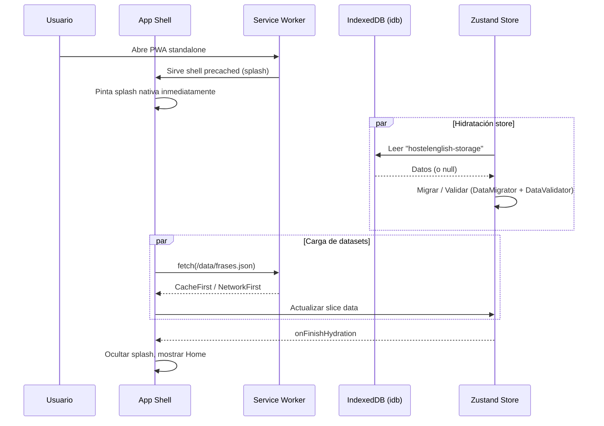

# [F1-Discovery] Arquitectura y Stack 2026 — HostelEnglish PWA

> **Estado:** Borrador de arquitectura para Discovery F1.  
> **Alcance:** Evaluación de stack y diseño de migración. No incluye implementación en `src/`.  
> **Referencia de diagnóstico:** `docs/DIARIO_DESARROLLO.md`, `openspec/changes/cve-react-router-v8`, `package.json`, `vite.config.ts`, `tsconfig.json`, `src/store/`, `src/db/`, `src/router/`, `src/monitoring/`.

---

## 1. Resumen ejecutivo

HostelEnglish PWA parte de una base sólida (React 18 + Vite 8 + TypeScript Strict + Zustand sliced + Vitest 4), pero acumula dos deudas técnicas bloqueantes:

1. **CVE en `react-router` 7.x** documentada en `openspec/changes/cve-react-router-v8`. La ruta a v8 está condicionada a React 19, que aún no se ha adoptado.
2. **Resiliencia offline incompleta**: la pantalla negra en standalone (parche v2.5.2) es un síntoma de que la hidratación de Zustand ↔ IndexedDB sigue acoplando el ciclo de vida del shell al almacenamiento.

Objetivo de esta fase: definir la arquitectura 2026 para un upgrade limpio de dependencias y una experiencia offline a prueba de fallos, manteniendo los 75 tests unitarios existentes y añadiendo cobertura E2E móvil.

---

## 2. Diagnóstico del stack actual

| Capa | Actual | Observaciones |
|---|---|---|
| **Framework** | React 18.2 | Estable, pero sin acceso a React Compiler ni APIs de 19. |
| **Bundler** | Vite 8 (Rolldown) | Ya usa motor moderno. `@vitejs/plugin-react` 6.0.2 sin Babel. |
| **Lenguaje** | TypeScript 5.4 Strict | `skipLibCheck: true`, `moduleResolution: bundler`. |
| **Estado** | Zustand 4.5 (slices) | Persistencia custom sobre `idb`. Hidratación async ya implementada, pero el shell depende de ella. |
| **Router** | `react-router` 7.18.1 | CVE activa. Bloqueo a v8 por peer de React 19. |
| **PWA** | `vite-plugin-pwa` 1.3.0 (Workbox) | `registerType: "autoUpdate"`, `injectRegister: "script"`. |
| **CSS** | Tailwind 3.4 + PostCSS 8.5 | Sin Lightning CSS; compilación más lenta que v4. |
| **Tests** | Vitest 4 (75 tests) | jsdom + Testing Library. Sin E2E móvil. |

### 2.1 Problemas conocidos detallados

- **Pantalla negra standalone**: en `AppInitializer`, el shell espera `hasHydrated` antes de renderizar la app. Si IndexedDB tarda > 4s o el store no hidrata, el usuario ve recovery o pantalla de error. Esto no debería ocurrir nunca en una PWA offline-first.
- **CVE Router**: `react-router` 7.x tiene una advisory HIGH para el rango 7.12.0–8.2.0. La migración a v8 exige React 19.2.7+ y Node 22.22+.
- **Dependencia circular potencial**: `vite-plugin-pwa` actual usa Workbox v7.3.0; la actualización a Workbox v7+ requiere migrar la clave `workbox` a `generateSW` en versiones futuras del plugin.

---

## 3. Matriz de dependencias objetivo

| Paquete | Actual | Objetivo 2026 | Requisito mínimo | Riesgo |
|---|---|---|---|---|
| `react` / `react-dom` | ^18.2.0 | ^19.0.0 (19.x latest) | Node 20.19+ / 22.12+ | Bajo — API mayormente compatible; elimina warnings. |
| `@vitejs/plugin-react` | ^6.0.2 | ^6.x (mantener o pin 6.0.x) | Vite 8 | Bajo — soporta React 19 y React Compiler opcional. |
| `zustand` | ^4.5.2 | ^5.0.x | React 18+ | Medio — cambio de default export a named exports; `persist` tiene cambios de comportamiento. |
| `react-router` / `react-router-dom` | ^7.18.1 | ^8.x | React 19.2.7+, Node 22.22+ | Medio/Alto — `react-router-dom` desaparece; DOM APIs pasan a `react-router/dom`. |
| `tailwindcss` | ^3.4.4 | ^4.x | Node 20+ | Medio — migración de `@tailwind` a `@import "tailwindcss"` y `tailwind.config.js` a `@theme`. |
| `postcss` | ^8.5.20 | ^8.x ( Lightning CSS en Tailwind v4 ) | — | Bajo. |
| `autoprefixer` | ^10.4.27 | Opcional en Tailwind v4 | — | Bajo — Tailwind v4 incluye vendor prefixing interno. |
| `vite-plugin-pwa` | ^1.3.0 | ^0.21.x (última 0.21) | Vite 8, Node 20.19+ | Medio — cambiar `workbox` por `generateSW`. Workbox sube a 7.3.0. |
| `workbox-window` | ^7.0.0 | `@vite-pwa/workbox-window` | — | Bajo — rename de paquete si se usa la última versión del plugin. |
| `idb` | ^7.1.1 | Mantener | — | Bajo. |
| `vitest` | ^4.1.8 | ^4.x (mantener) | — | Bajo. |
| `typescript` | ^5.4.5 | ^5.x (5.7+) | — | Bajo. |

**Nota sobre `vite-plugin-pwa` vs `@unplugin-pwa/vite`**:  
Existe una versión “siguiente” (`@unplugin-pwa/vite`) que requiere Vite 6+ y Node 22.14+. Dado que el proyecto está en Vite 8 y Node 26, es viable, pero introduce un cambio de API mayor (`generateSW` por defecto, manejo de estrategias dual classic/module). Para minimizar riesgo, recomendamos **permanecer en `vite-plugin-pwa` 0.21.x** y migrar a `@unplugin-pwa/vite` solo si se necesitan capacidades ESM-only del service worker.

---

## 4. Arquitectura offline definitiva

### 4.1 Diagrama de arquitectura (Mermaid)

```mermaid
flowchart TD
    subgraph Cliente
        A[index.html] --> B[App Shell (splash nativa)]
        B --> C{Store hidratado?}
        C -->|Sí| D[App con datos]
        C -->|No| E[Splash + precache warm-up]
        E --> C

        F[SW Registration\n(autoUpdate)] --> G[Service Worker (Workbox 7)]
        G --> H[Precached Assets]
        G --> I[Runtime Cache\nEstrategias por tipo]
        I --> I1[App Shell: CacheFirst]
        I --> I2[Data JSONs: NetworkFirst\nfallback Cache]
        I --> I3[Audio: CacheFirst\nWebM/Opus]
        I --> I4[Imágenes: CacheFirst]

        J[Background Sync Queue\n(IndexedDB)] --> K[Sync Event / Fallback online]
        K --> L[Replay POST stats/progreso]
    end

    subgraph Workers
        M[Web Worker: Índice búsquedas\n640+ frases] --> N[postMessage resultados]
        O[Web Worker: Métricas retención\nFitts / Leitner] --> N
    end

    N --> C
```

### 4.2 Principios de diseño

1. **App shell nunca bloquea**: el HTML + CSS minimal debe pintarse en < 100ms sin depender de Zustand ni IndexedDB. El splash nativo PWA (`manifest.theme_color` + `background_color` + `display: standalone`) actúa como respaldo visual mientras el shell hidrata.
2. **Hidratación no bloqueante**: Zustand persiste en `idb`, pero la UI renderiza un skeleton mínimo con los datos cacheados en memoria (si existen). La hidratación ocurre en background; si tarda > 2s, se muestra skeleton con spinner (no pantalla negra).
3. **Service Worker como fuente de verdad offline**: `generateSW` con `navigateFallback: '/HostelEnglishPWA/'` y `NavigationRoute` + `createHandlerBoundToURL`. Estrategias diferenciadas por tipo de recurso.
4. **Background Sync para mutaciones**: estadísticas de quiz, progreso y configuración viajan en una cola en IndexedDB cuando no hay red; el SW las replaya al recuperar conexión usando `workbox-background-sync` + fallback por evento `online`.
5. **Web Workers para CPU-bound**: indexación de búsquedas y cálculo de métricas de retención se aislan del hilo principal.

---

## 5. Plan de migración paso a paso

### Fase 0 — Preparación (sin tocar producción)

- Crear rama `feat/stack-2026-upgrade`.
- Ejecutar `npx @tailwindcss/upgrade` en rama feature para obtener el mapa automático de v3 → v4.
- Actualizar `@vitejs/plugin-react` a 6.x si no está en latest.
- Documentar en `docs/plan-2026/03_ARQUITECTURA_Y_STACK_2026.md` este plan.

### Fase 1 — React 19 + Router v8 (desbloqueo de CVE)

1. **Node/engines**: confirmar Node 22.22+ en CI (actualmente Node 26 en local, CI debe alinearse).
2. **React 19**:
   - `npm install react@19 react-dom@19`.
   - Cambiar `import { create } from "zustand"` → `import { create } from "zustand/traditional"` (Zustand 5) o actualizar a `zustand` v5 en la siguiente fase.
   - Revisar uso de `forwardRef` ( eliminado en React 19 como requerimiento, pero no rompe ).
   - Verificar `React.lazy` + `Suspense` para `/progreso`.
3. **Router v8**:
   - `npm install react-router@8 react-router-dom` **ya no existe**; eliminar `react-router-dom`.
   - Cambiar imports: `import { Link, NavLink, useLocation } from "react-router"` y DOM helpers desde `"react-router/dom"`.
   - Revisar `HashRouter` vs `BrowserRouter`. `HashRouter` sigue existiendo en `react-router/dom`.
   - Actualizar tests con `MemoryRouter` si la API cambió (v8 mantiene `MemoryRouter` en `react-router`).
4. **Verificación**: `npm run ci:check` y `npm test` (75 tests deben mantenerse en verde).

### Fase 2 — Tailwind CSS v4 + CSS-first theme

1. `npm install -D tailwindcss@latest postcss@latest`.
2. `npx @tailwindcss/upgrade` para migrar automáticamente:
   - `@tailwind base/components/utilities` → `@import "tailwindcss"`.
   - `tailwind.config.js` → `@theme` block en CSS o mantener config minimal si hay plugins complejos.
3. Migrar colores personalizados a variables CSS en `@theme`:
   - `--color-primary`, `--color-accent`, etc.
   - Mover `fontFamily`, `borderRadius` al bloque `@theme`.
4. Eliminar `autoprefixer` del `postcss.config.js` (Tailwind v4 usa Lightning CSS internamente) o mantener si hay CSS propio con prefijos.
5. Verificar build y estilos visuales en mobile/desktop.

### Fase 3 — Zustand 5 + Persistencia robusta

1. `npm install zustand@5`.
2. Migrar imports: de `import { create } from "zustand"` a `import { create } from "zustand/traditional"` (o `createWithEqualityFn` si usan `shallow`).
3. Revisar cambios en `persist`:
   - `version` ya no se auto-persiste en initial state (se eliminó en v4.5.5/v5).
   - Asegurar que `partialize` sigue capturando solo lo necesario.
4. Añadir fallback de carga perezosa: si `getItem` de IndexedDB falla, retornar `null` y dejar que el store arranque con defaults; rehidratar en background.

### Fase 4 — PWA Offline Definitiva (Workbox v7 + Background Sync)

1. **Service Worker lifecycle**:
   - Cambiar `workbox: { globPatterns: [...] }` por `generateSW: { ... }` en `vite-plugin-pwa` 0.21.x.
   - Añadir `navigateFallback: '/HostelEnglishPWA/'` + `NavigationRoute` con `createHandlerBoundToURL` para SPA offline.
   - Estrategias:
     - App shell: `CacheFirst`.
     - Datos JSON (`/data/*.json`): `NetworkFirst` con `networkTimeoutSeconds: 3`, fallback a cache.
     - Audio: `CacheFirst` con `ExpirationPlugin` (max 50 entries).
2. **Background Sync**:
   - Añadir `workbox-background-sync` (vía `injectManifest` si se necesita lógica custom, o `BackgroundSyncPlugin` con `generateSW` si el plugin lo soporta).
   - Registrar sync tags: `stats-sync`, `progress-sync`.
   - En el cliente, interceptar `fetch` de stats/progreso; si falla, encolar en IndexedDB.
3. **Inicialización no bloqueante**:
   - Refactor de `AppInitializer` (solo diseño, no implementación): renderizar shell inmediatamente con splash nativo; arrancar `initDB` y `useAppStore.persist.rehydrate` en paralelo.
   - Mostrar skeletons en lugar de loader absoluto; usar datos cacheados en RAM si existen.
   - Eliminar el estado de “pantalla negra” sustituyéndolo por skeleton + botón “Reintentar”.

### Fase 5 — Rendimiento y Assets

1. **Web Workers**:
   - `src/workers/searchIndex.worker.ts`: recibe `frases[]`, construye índice invertido por palabra, responde a consultas con `postMessage`.
   - `src/workers/metrics.worker.ts`: calcula métricas de retención (Fitts, Leitner) sobre `progress[]`.
   - Vite soporta workers nativos con `new Worker(new URL('./worker.ts', import.meta.url), { type: 'module' })`.
2. **Audio optimizado**:
   - Proponer pipeline de conversión a WebM/Opus 64kbps para frases.
   - En `<audio>`: `<source src="...webm" type="audio/webm; codecs=opus">` con fallback MP4/AAC.
   - Precaching granular: audios se cachean por `CacheFirst` con límite de entradas.
3. **Precaching granular**:
   - Precaché inicial: solo app shell + fonts critical (Inter wght 400/600/700).
   - Datos y assets pesados se descargan bajo demanda y cachean en runtime.

### Fase 6 — Testing y Quality Gates

1. **Mantener suite actual**: 75 tests en Vitest + jsdom.
2. **E2E móvil con Playwright**:
   - `@playwright/test` con `use({ ... })` emulando móvil (viewport 375x812, touch, slow 4G).
   - Proyecto `playwright/` con config para GitHub Pages base URL (`/HostelEnglishPWA/`).
   - Tests críticos:
     - `offline.spec.ts`: instalar PWA, apagar red, navegar entre frases/quiz, volver a conectar, verificar Background Sync.
     - `hydration.spec.ts`: verificar que el shell pinta en < 1s y no queda en negro con IndexedDB lento (mock con `fake-indexeddb` + delay).
     - `router.spec.ts`: smoke test de rutas tras upgrade a v8.
3. **CI**:
   - Quality gates: `tsc --noEmit`, `eslint`, `vitest run`, `vite build`, `playwright test`.
   - Bloquear merge si cualquier gate falla.

---

## 6. Diagrama de secuencia: inicialización offline



---

## 7. Riesgos y mitigaciones

| Riesgo | Probabilidad | Impacto | Mitigación |
|---|---|---|---|
| Breaking changes en React 19 + Router v8 | Media | Alto | Probar en rama feature primero; mantener `HashRouter` si `BrowserRouter` introduce problemas de routing en GH Pages. |
| Tailwind v4 rompe estilos custom | Media | Medio | Usar `npx @tailwindcss/upgrade` y diff visual exhaustivo en mobile + desktop. |
| Zustand v5 migración de slices | Baja | Medio | Actualizar a latest v4 primero para obtener warnings; luego migrar a v5 con named imports. |
| Service Worker viejo en clientes | Media | Alto | Mantener un “self-destroying SW” temporal si cambiamos de arquitectura; de lo contrario, `generateSW` con mismo nombre renueva limpio. |
| Web Workers aumentan complejidad | Baja | Bajo | Usar `workerize-loader` patrón nativo de Vite; mantener workers puros (sin dependencias de UI). |
| Playwright en CI aumenta coste/tiempo | Media | Bajo | Ejecutar solo en PRs a main; usar `--shard` y `--grep` para tests críticos. |

---

## 8. Criterios de aceptación

1. **Stack actualizado**: `package.json` refleja React 19, Router v8, Tailwind v4, Zustand v5, `vite-plugin-pwa` 0.21.x. No hay dependencias con vulnerabilidades HIGH en `react-router`.
2. **75 tests verdes**: suite de Vitest existente pasa sin cambios o con adaptaciones mínimas.
3. **PWA offline**:
   - `npm run build` + instalación en dispositivo: app pinta en < 1s sin red.
   - Navegación completa entre rutas offline.
   - Audio cacheado y reproducible offline.
4. **Background Sync**: mutaciones de progreso realizadas offline se sincronizan al recuperar conexión (verificable con DevTools → Application → Service Workers → Background Sync).
5. **Web Workers**: búsqueda de frases y cálculo de métricas no bloquean el hilo principal (Performance profiling).
6. **E2E Playwright**: al menos 3 specs móviles pasando en CI (offline flow, hydration, router).
7. **Documentación**: este archivo aprobado y referenciado desde `docs/DIARIO_DESARROLLO.md`.

---

## 9. Próximos pasos sugeridos (follow-up)

1. Crear ADR `adr-2026-stack-upgrade` con esta decisión.
2. Crear tarea Kanban para **Dev** con el plan de migración fase por fase.
3. Crear tarea Kanban para **QA** con suite Playwright móvil.
4. (Opcional) RFC para cambio de `vite-plugin-pwa` → `@unplugin-pwa/vite` en una fase posterior.

---

*Documento generado por el perfil `arquitectura` — Michel Macias. Noviembre 2026.*
