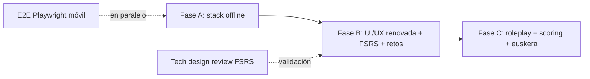

# HostelEnglish PWA 2026 — Plan Maestro

**Autor:** Equipo de Producto, Arquitectura, UX y IA
**Fecha:** 2026-11-01
**Producto:** HostelEnglish PWA (hostelería, enfoque en fluidez laboral)
**Estado:** Plan Maestro consolidado para implementación F2  \n
**Fuente:** 01_PRODUCTO_ROADMAP_2026.md · 02_SISTEMA_DISENO_Y_UX_2026.md · 03_ARQUITECTURA_Y_STACK_2026.md · 04_CAPA_IA_Y_AUDIO_2026.md

> Este documento sintetiza y consolida la información de los cuatro estudios sectoriales de la Fase 1. Solo se consolida; **no se altera código fuente**. Las decisiones técnicas provienen de `03_ARQUITECTURA_Y_STACK_2026.md` y `04_CAPA_IA_Y_AUDIO_2026.md`; la visión de producto de `01_PRODUCTO_ROADMAP_2026.md`; y la estética de `02_SISTEMA_DISENO_Y_UX_2026.md`.

---

## 1. Resumen Ejecutivo

**Elevator pitch:** HostelEnglish 2026 pasa de app de frases a **entrenador de fluidez laboral offline-first para hostelería**: micro-lecciones de 2-3 min adaptativas, scheduler espaciado (FSRS), retos diarios por rol, roleplay conversacional guiado y scoring fonético, todo medido contra escenarios reales de la industria, sin dependencia de cloud.

**Problema central:** El personal de hostelería necesita práctica contextual y continua en turnos rotatorios. Las apps genéricas no se adaptan a sus escenarios, ni a su tiempo disponible, y miden solo aciertos aisladas.

**Diferenciación propuesta:**
- Segmentación real por rol (Recepción, Bar, Restaurante, Limpieza, Mantenimiento) con rutas adaptativas.
- Scheduler espaciado local (FSRS-6) sin dependencia de cloud ni backend.
- Práctica conversacional guiada por objetivo (roleplay) con motor de IA on-device prioritario y fallback API.
- Metricas de fluidez (ritmo, precisión, prosodia), no solo exactitud.
- PWA offline resiliente: aplicación mantiene función completa sin red y sincroniza mutaciones por background sync.

**Mejoras clave del 2026:**
1. FSRS-6: repetición espaciada inteligente con parámetros por ítem, reemplazando la progresión lineal 0→3.
2. Retos diarios contextuales por rol (micro-misiones situacionales).
3. Módulo de roleplay conversacional guiado (IA como cliente, usuario en escenario de hospitalidad).
4. Scoring fonético de pronunciación (accuracy, completeness, fluency, prosody) con catálogo de errores hispanohablantes.
5. Soporte nativo de euskera: piper basco + whisper-base-eu, eliminando el parche `euToEsPhonetic`.
6. Renovación total del sistema de diseño (tokens unificados, dark/light/auto, tipografía adaptativa).
7. Hardening técnico: React 19, Router v8, Zustand 5, Tailwind v4 y PWA offline definitivo.

---

## 2. Arquitectura y Stack Aprobado

Estos son los decisiones técnicas previamente validadas en `03_ARQUITECTURA_Y_STACK_2026.md` y `04_CAPA_IA_Y_AUDIO_2026.md`. No se modifican en F2; se abordan en Fase A.

### 2.1 Matriz de dependencias objetivo

| Paquete | Actual | Objetivo 2026 | Requisito mínimo | Riesgo |
|---|---|---|---|---|
| `react` / `react-dom` | ^18.2.0 | ^19.0.0 | Node 20.19+ / 22.12+ | Bajo — API compat. mayor; elimina warnings |
| `@vitejs/plugin-react` | ^6.0.2 | ^6.x | Vite 8 | Bajo |
| `zustand` | ^4.5.2 | ^5.0.x | React 18+ | Medio — named imports; `persist` cambios de comportamiento |
| `react-router` / `react-router-dom` | ^7.18.1 | ^8.x | React 19.2.7+, Node 22.22+ | Medio/Alto — `react-router-dom` desaparece |
| `tailwindcss` | ^3.4.4 | ^4.x | Node 20+ | Medio — `@import "tailwindcss"` + `@theme` CSS-first |
| `vite-plugin-pwa` | ^1.3.0 | ^0.21.x (Workbox 7.3) | Vite 8, Node 20.19+ | Medio — migrar clave `workbox` a `generateSW` |
| `postcss` | ^8.5.20 | ^8.x (Lightning CSS) | — | Bajo |
| `idb` | ^7.1.1 | Mantener | — | Bajo |
| `vitest` | ^4.1.8 | ^4.x | — | Bajo |
| `typescript` | ^5.4.5 | ^5.x (5.7+) | — | Bajo |

> Nota: se mantiene `vite-plugin-pwa` 0.21.x (Workbox 7.3) en vez de migrar a `@unplugin-pwa/vite`. Solo si se necesita ESM-only del service worker se considera el cambio posterior.

### 2.2 Principios de arquitectura

1. **App shell nunca bloquea**: HTML+CSS mínimo se pinta en < 100 ms sin depender de Zustand ni IndexedDB; splash nativo PWA + skeleton, no pantalla negra.
2. **Hidratación no bloqueante**: Zustand persiste en `idb`; UI renderiza skeleton mínimo con datos cacheados en memoria; hidratación en background; > 2 s se muestra skeleton con spinner.
3. **Service Worker como fuente de verdad offline**: `generateSW` con `navigateFallback: '/HostelEnglishPWA/'` y `NavigationRoute` + `createHandlerBoundToURL`; estrategias diferenciadas:
   - App shell: `CacheFirst`
   - Datos JSON (`/data/*.json`): `NetworkFirst` (3 s timeout, fallback a cache)
   - Audio (WebM/Opus): `CacheFirst` (máx 50 entradas)
   - Imágenes: `CacheFirst`
4. **Background Sync para mutaciones**: estadísticas, progreso y configuración en cola IndexedDB cuando no hay red; replay via `workbox-background-sync` + fallback por evento `online`.
5. **Web Workers para CPU-bound**: indexación de búsqueda (640+ frases) y cálculo de métricas de retención (`Fitts`/`Leitner`) fuera del hilo principal.
6. **Privacidad por diseño**: solo telemetría local en IndexedDB; sin envío a terceros sin opt-in explícito.

### 2.3 Módulo de audio y capa IA (resumen)

| Área | Ruta primaria (on-device) | Ruta secundaria (híbrida) | Fallback nativo |
|---|---|---|---|
| TTS | Piper (WebGPU/WASM) | Cloudflare Workers AI streaming | Web Speech Synthesis |
| ASR | Transformers.js Whisper (Web Worker) | Cloudflare Workers AI Whisper | Web Speech Recognition |
| LLM (roleplay) | Transformers.js / WebLLM 1B–3B | Cloudflare Workers AI `@cf/meta/llama-3.2-3b-instruct` | Gemini 2.5 Flash/3.8 Flash |
| Euskera | Piper Antton/Maider + Whisper-base-eu | — | Web Speech API |

**Stack tecnológico recomendado (dependencias core):**
```json
{
  "@huggingface/transformers": "^3.8.1",
  "@mlc-ai/web-llm": "^0.2.85",
  "onnxruntime-web": "latest",
  "espeak-ng": "latest",
  "piper-tts": "latest",
  "wavefile": "latest"
}
```

**Benchmarks clave:** Llama 3.2 1B q4 en WebGPU: 27–67 tok/s, p50 ~52 ms, cold start 1.4–3 s, ~0.7 GB VRAM. Whisper Base q8: 4–8 s/30s audio, < 1 s cold start. WER Basque Whisper-large-v2-eu: 11.34%; Whisper-base-eu: 25.98%.

---

## 3. Especificación Funcional y UX

### 3.1 Modelo de aprendizaje y gamificación

**FSRS-6 (spanish repetition system):** reemplaza la escala fija 0→3 por tres parámetros por ítem: `difficulty` (dificultad), `stability` (estabilidad) y `retrievability` (recuperabilidad), con objetivo de retención ajustable (p.ej. 90%). El scheduler local calcula los intervalos y se entrena con el historial local. Resultado esperado: hasta ~30-40% menos repeticiones innecesarias manteniendo retención.

Esquema de reviewMemory (añadido a `src/models/schemas.ts`):

```ts
export const ReviewMemorySchema = z.record(
  z.string(),
  z.object({
    difficulty: z.number(),
    stability: z.number(),
    retrievability: z.number(),
    dueDate: z.string().datetime(),
    lapses: z.number().default(0),
    reps: z.number().default(0),
  })
);
```

**Retos diarios:** micro-misión generada y priorizada diariamente. Un reto por día, rotación por departamento según preferencia. No acumulación de deudas: si se pierde un día, el reto se reemplaza. Recompensas: XP + bonificador de racha + desbloqueo de escenario de roleplay.

**Certificaciones por rol:** cada rol (recepción, bar, etc.) define un subconjunto priorizado de frases, conversaciones obligatorias y opcionales, y certificación inicial + recertificación cada 90 días. Métrica de fluidez = velocidad media de respuesta oral + precisión léxica + tasa de aciertos en roleplay. Insignias verificables exportables.

**Gamificación con propósito:** rachas, XP y mundos conservados; diferencia es mastery-based progression (desbloqueo de capacidad real, no solo puntos). Se añade `fsrs_week`, `role_master_<role>` y `streak_30` al slice `achievements`.

### 3.2 Roleplay conversacional guiado

Flujo: elegir escenario → app guía con frases clave sugeridas → el usuario producelas oralmente → Speech Recognition valida pronunciación + léxico → post-sesión: informe con aciertos, errores recurrentes y frases para repasar.

Diseño de prompt (por escenario hotelero):

```
System: Eres un cliente en un hotel británico formal / estadounidense casual.
Situation: {checkin|room_service|complaint|checkout}
Constraints:
- Vocabulario nivel B1-B2, hotelero.
- 1 pregunta o petición por turno como máximo.
- Si el alumno se bloquea > 8 s, ofrece una pista suave.
- No reveles que eres IA.
```

Roleplay MVP: 5 escenarios piloto en Fase 2; ampliación a 20+ en Fase 3. El LLM on-device es suficiente para dominio B1-B2 hotelero según benchmarks.

### 3.3 Sistema de diseño

Tokens unificados en CSS variables + `@theme` de Tailwind v4; única fuente de verdad para color, tipografía, espaciado, radius, duraciones y sombras.

**Modos:**
- `dark` (predeterminado): fondo `#0f1419`, superficie `#1a2332`, acento `#e67e22`.
- `light` (opcional): fondo `#f5f7fa`, superficie `#ffffff`.
- `auto`: `prefers-color-scheme` + sensor de luz ambiental (si disponible).

**Jerarquía tipográfica:** `text-5xl` 48px/800-900 (hero), `text-4xl` 36px/800 (H1), `text-3xl` 30px/700 (H2), `text-2xl` 24px/700 (H3/hero), `text-xl` 20px/600, `text-base` 16px/400, `text-sm` 14px/400, `text-xs` 12px/500. Nunca se usan weights inferiores a 400 en texto interactivo.

**Navegación responsive:**
- `< md` móvil: BottomNav (fijo, 64px + safe-area, hasta 5 items) + SideNav como drawer.
- `md - lg` tablet: BottomNav oculta; SideNav drawer con botón toggle.
- `≥ xl` desktop: SideNav rail colapsado (w-20) o expandido (w-72, ≥ 1280px), TopNav sticky con logo y acciones de tema/usuario; vista dividida opcional (sidebar + pane de estudio + rail de estadísticas).

**Componentes nuevos:** Waveform (mediante `AnalyserNode`, idle/listening/recording/processing/result), Bottom Sheet (snapshots 25/50/90%, drag threshold 20%), Skeleton loading, Empty/Error states, Flashcard 3D (600 ms spring), Toast con anidación, Toggle 48x28px.

**Controles y feedback:** botones 48x48px mínimo (56x56px preferido), touch targets verificados por script en dev; haptic granular con mapa de eventos (acierto `[15]`, fracaso leve `[10,30,10]`, error crítico `[40,20,40]`, racha `+50`; etc.); live region para estado de audio (a11y).

**Accesibilidad:** WCAG AAA en modo oscuro (≥ 7:1 contraste), AA en light; focus-visible 2px solid + 2px offset; skip-link y landmarks obligatorios; `prefers-reduced-motion` (todas las animaciones ≤ 1 ms).

### 3.4 Estados de pantalla

| Estado | Comportamiento |
|---|---|
| Loading | Skeleton con shimmer; ≤ 1.5 s permanente (antes loader) |
| Empty | Icono, título, descripción, CTA dirigida (p.ej. "Añade tu primera frase") |
| Error | Icono, título, descripción técnica, CTA "Reintentar" + "Volver al inicio" |

---

## 4. Plan de Fases de Ejecución

La tabla de priorización de 01_PRODUCTO_ROADMAP_2026.md se mapea en tres fases ejecutables. Las fases se entierran en la rama `feat/...` correspondiente y usan calavera de merge; no hay branch transversal.

### 4.1 Fase A — Hardening técnico y stack (8–10 semanas)

**Objetivo:** eliminar las deudas técnicas que bloquean el desarrollo y establecer la base offline/productividad.

**Entregables:**
- Actualización a React 19 + Router v8 (desbloqueo CVE react-router 7.x), Zustand 5, Tailwind v4.
- PWA offline definitivo: `generateSW`, estrategias CacheFirst/NetworkFirst/Background Sync, splash nativa + skeleton no bloqueante.
- Web Workers de búsqueda y métricas; precache granular.
- Suite E2E Playwright móvil: 3 specs críticas (offline, hydration, router).
- Criterios de aceptación:
  1. `package.json` refleja React 19, Router v8, Zustand 5, Tailwind v4, `vite-plugin-pwa` 0.21.x.
  2. Sin dependencias HIGH vulnerables en `react-router`.
  3. 75 tests existentes verdes (`npm test`).
  4. PWA offline: build + instalación → pinta en < 1 s sin red; navegación completa; audio reproducible.
  5. Background Sync: mutaciones offline se reproducen al recuperar conexión (DevTools → Background Sync).
  6. Web Workers: búsqueda/métricas no bloquean UI (profiling).
  7. 3 specs Playwright móviles pasando en CI.

### 4.2 Fase B — UI/UX renovada y audio visual (10–12 semanas)

**Objetivo:** implementar el sistema de diseño y los módulos que el usuario percibe como nuevos.

**Entregables:**
- Unificación de tokens en `tailwind.config.js` v4/`@theme` + CSS variables; eliminación de la escala 80% hardcodeada.
- Theme engine (auto/manual) con `useTheme` hook y switching runtime.
- SideNav colapsable con estado persistido; TopNav sticky; vista dividida.
- Waveform para audio; estados de audio UI (idle/listening/processing/result); feedback háptico granular.
- FSRS-6: slice `reviewSlice.ts` con cola `duePhrases`, API de scheduler, migración de `progress` → `reviewMemory` (DataMigrator).
- Retos diarios (engine + UI) y selección de rol en onboarding + filtros por rol en dashboard.
- Certificación por rol básica y dashboard de competencias.
- Criterios de aceptación:
  1. Todos los tokens de diseño unicados; sin media query hardcodeada al 80%.
  2. Onboarding de rol: usuario elige su departamento; dashboard filtra contenido por rol.
  3. Sesión de 2-3 min con ítems FSRS programados + reto diario mostrado.
  4. Waveform visible en reproducción; feedback háptico mapeado por evento.
  5. Certificación por rol emitida (mínimo 1 usuario).

### 4.3 Fase C — IA conversacional, scoring y ampliación (6–8 semanas)

**Objetivo:** cerrar la oferta diferencial con la capa IA y completar la cobertura de contenido.

**Entregables:**
- Roleplay conversacional MVP: 5 escenarios, LLM on-device (Transformers.js/WebLLM 1B–3B en Worker) + pistas en tiempo real y corrección post-turno.
- Scoring fonético: pipeline con `espeak-ng` + DTW/Wav2Vec2, `phoneticScorer.ts`, catálogo de errores hispanohablantes, feedback visual rápido.
- Ampliación de roleplays a 20+ escenarios; cobertura de los 5 departamentos core.
- AI-assisted content generation: variantes de frases y distractores (Fase 3, como feature opt-in, no core).
- Soporte de euskera: Piper Basque reemplaza al parche `euToEsPhonetic`; Whisper-base-eu en Transformers.js (WebGPU/WASM).
- Criterios de aceptación:
  1. Roleplay: 5 turnos coherentes sin alucinaciones fuera de dominio; latencia p95 < 5 s en gama media.
  2. Scoring fonético: correlación > 0.7 con juicio humano en dataset de 50 frases.
  3. Euskera: 100% cobertura en dispositivos testados (Chrome Android, Safari iOS, desktop); cero dependencia de Google Translate TTS.
  4. Fallback API (Workers AI / Gemini) funcional en dispositivos sin WebGPU.

### 4.4 Mapa de dependencias



---

## 5. Backlog de Tareas Kanban Preparadas

Solo para crear el tablero de implementación. Los roles válidos son: `dev`, `frontend`, `ia`, `ui-polish`, `caos` (cosas que no se pueden asignar clara y se revisan).

El Plan Maestro es fuente de verdad; las tarjetas creadas en Kanban deberían mantener el mismo `ID`, `Alcance` de fase, `Asignado` y `Criterios de aceptación` de abajo.

### 5.1 Tarjetas por Fase A

| ID | Título | Asignado | Alcance | Criterios de aceptación |
|---|---|---|---|---|
| A-01 | Actualizar a React 19 + Router v8 (desbloqueo CVE) | dev | Fase A | `package.json` a 19 y Router 8; imports de `react-router/dom` refactorizados; `npm test` verde; no rompen routes |
| A-02 | Migrar Zustand 5 + persistencia robusta | dev | Fase A | Named imports; `persist` behaviour update aplicada; store inicia con defaults si IndexedDB falla |
| A-03 | Migración Tailwind v4 + `@theme` CSS-first | frontend | Fase A | `@import "tailwindcss"` en `index.css`; `tailwind.config.js` reemplazado por `@theme`; build limpio; estilos visuales no rotos en mobile/desktop |
| A-04 | PWA offline definitivo (generateSW + estrategias) | dev | Fase A | `generateSW` en `vite-plugin-pwa` 0.21.x; App shell CacheFirst; datos NetworkFirst 3 s; audio CacheFirst max 50 entradas |
| A-05 | Background Sync para stats/progreso | dev | Fase A | Mutaciones offline encola en IndexedDB; replay via `workbox-background-sync` + fallback `online`; verificable en DevTools |
| A-06 | Splfloat nativo + skeleton no bloqueante | frontend | Fase A | Shell pinta < 100 ms sin Zustand; splash nativo PWA; skeleton en > 2 s; sin pantalla negra |
| A-07 | Web Workers: índice de búsqueda + métricas | dev | Fase A | Workers puros (sin UI); búsqueda de 640+ frases no bloquea UI; métricas retention calculadas fuera del hilo principal |
| A-08 | Suite E2E Playwright móvil (offline, hydration, router) | qa | Fase A | 3 specs críticas pasando (offline, hydration < 1 s, router smoke) en CI; garantizan el criterio A-4 |
| A-09 | Review de arquitectura + ADR `adr-2026-stack-upgrade` | caos | Fase A | ADR documentado; decisiones consensuadas con Michel; referenciado desde `docs/DIARIO_DESARROLLO.md` |

### 5.2 Tarjetas por Fase B

| ID | Título | Asignado | Alcance | Criterios de aceptación |
|---|---|---|---|---|
| B-01 | Unificar tokens de diseño en `@theme` + CSS variables | ui-polish | Fase B | Sin media query hardcodeada al 80%; tokens en un solo lugar; dark/light/auto funcionando |
| B-02 | Theme engine (auto/manual/runtime) | frontend | Fase B | `useTheme` hook; switch runtime; `prefers-color-scheme` + sensor; reduced-motion respetado |
| B-03 | SideNav colapsable (estado y persistencia) | frontend | Fase B | Expandido ≥ 1280px; colapsado (w-20) por defecto en `<1280px`; overlay backdrop; transición 300 ms; persistido |
| B-04 | TopNav sticky + vista dividida (desktop ≥ 1280px) | frontend | Fase B | TopNav con logo/botón tema/avatar; vista dividida: sidebar + pane + stats rail; contenido `max-w-7xl` |
| B-05 | Refactorizar BottomNav y SideNav por spec | frontend | Fase B | BottomNav 64px + safe-area, 5 items max; SideNav drawer; touch targets ≥ 48x48 |
| B-06 | Sistema de botones, cards, sheets, inputs | frontend | Fase B | Badges, toasts, skeleton, flashcard 3D, waveforms según spec 6.x |
| B-07 | Waveform para audio + estados visuales | frontend | Fase B | AnalyserNode en listening; color accent/info; idle pulse; RECORDING pulso central; resultados en feedback |
| B-08 | Feedback háptico granular | ui-polish | Fase B | Mapa de eventos implementado (acierto, fracaso, error crítico, racha, navegación, pull-to-refresh, sheet snap) |
| B-09 | FSRS-6: `reviewSlice` y migración de `progress` | dev | Fase B | Cola `duePhrases`; parámetros `difficulty/stability/retrievability` por frase; migración via DataMigrator; 30–40% menos repeticiones innecesarias |
| B-10 | Retos diarios contextuales por rol | dev | Fase B | Un reto/día; rotación por departamento; recompensa XP + racha + desbloqueo roleplay; reemplazo sin deuda |
| B-11 | Onboarding de rol + filtros por rol | frontend | Fase B | Usuario elige rol en onboarding; dashboard, frases, flashcards y quiz filtrados por rol; default "General" |
| B-12 | Certificación por rol básica + dashboard de competencias | dev | Fase B | Certificación emitida por rol; dashboard de competencias (heatmap); métrica de fluidez avance |
| B-13 | A11y: skip-link, landmarks, live regions | ui-polish | Fase B | Skip-link + landmarks (`header/nav/main/footer`); live region para estado de audio; focus-visible 2px; contrastes WCAG AAA/AA |

### 5.3 Tarjetas por Fase C

| ID | Título | Asignado | Alcance | Criterios de aceptación |
|---|---|---|---|---|
| C-01 | AudioManager centralizado + selector por dispositivo | ia | Fase C | Selector por `navigator.gpu`/memoria; piper on-device primera opción; fallback Web Speech; tests `npm test` |
| C-02 | ASR en Web Worker (Transformers.js Whisper) | ia | Fase C | Transcripción en worker; WASM fallback; < 3 s cold start en WebGPU; no bloquea UI |
| C-03 | Roleplay conversacional MVP (5 escenarios) | ia | Fase C | 5 turnos coherentes sin alucinaciones fuera de dominio; latencia p95 < 5 s; system prompts por escenario |
| C-04 | Pistas en tiempo real + corrección post-turno | ia | Fase C | Pista suave > 8 s; corrección contextual pos-utterance; feedback en pantalla |
| C-05 | PhoneticScorer: espeak-ng + DTW + catálogo | ia | Fase C | Pipeline: grabación 16 kHz mono → transcripción referencia → fonemización → alineación DTW → scoring; correlación > 0.7 en 50 frases |
| C-06 | Feedback visual de pronunciación | frontend | Fase C | Resultado visual: accuracy/completeness/fluency/prosody; errores hispanohablantes resaltados |
| C-07 | WebLLM/Transformers.js LLM en Worker para roleplay | ia | Fase C | 1B–3B q4 en Worker; cold start < 3 s con cache; streaming p95 < 5 s; edge cases seguidos |
| C-08 | Fallback API (Workers AI / Gemini) para sin WebGPU | ia | Fase C | Funcional en Chrome Android, Safari iOS y desktop sin GPU; streaming SSE nativo; métricas en IndexedDB |
| C-09 | Soporte de euskera: Piper Basque + Whisper-base-eu | ia | Fase C | Piper reemplaza `euToEsPhonetic` y dependencia de Google Translate TTS; Whisper-base-eu en Transformsers.js; 100% cobertura testada |
| C-10 | Ampliar roleplays a 20+ escenarios | dev | Fase C | Cobre los 5 departamentos core; métricas comparables; data en `public/data/roleplays.json` |
| C-11 | AI-assisted content generation (variantes/distractores) | caos | Fase C | Funcional como opt-in (no core); variantes y distractores generados; revisión humana requerida |
| C-12 | Metrics de fluidez + reporte post-sesión | dev | Fase C | Fluidez = velocidad oral + precisión léxica + tasa roleplay; informe con aciertos, errores recurrentes y frases legenda |

### 5.4 Reglas del tablero

- Cada tarjeta se crea con el `ID` propuesto (auto-documenta dependencias y permite mapeo directo al Plan Maestro).
- `Alcance` permanece presente en el card; las tarjetas no se crean fuera de Fase A/B/C salvo que el Product Owner lo autorice.
- `don't touch` en código real: F2 es síntesis de documentación; la implementación empieza en los cards A-01 → C-12 con rama `feat/<card-id>-scope`.
- Criterios de aceptación son ejecutables: el dueño de la tarjeta puede verificarlas con los tests/assays definidos; el Product Owner puede añadir confirmación final.

---

## 6. Metas de éxito (de 01_PRODUCTO_ROADMAP_2026.md)

| Métrica | Fórmula | Umbral | Periodicidad |
|---|---|---|---|
| Retención D7 | % usuarios con ≥4 sesiones/7d ÷ activos día 1 | ≥ 35% | Semanal |
| Tiempo medio sesión | minutos/día ÷ sesiones | 2.5–4 min | Semanal |
| Carga de repaso FSRS | ítems vencidos ÷ total cola | ≤ 18% | Diario |
| Completitud reto diario | retos completados ÷ asignados | ≥ 60% | Diario |
| Certificaciones por rol | certificados ÷ usuarios ≥7 días | ≥ 15% | Mensual |

---

## 7. Riesgos y mitigaciones

| Riesgo | Probabilidad | Impacto | Mitigación |
|---|---|---|---|
| React 19 + Router v8 breaking changes | Media | Alto | Rama feature primero; mantener `HashRouter` si `BrowserRouter` rompe en GH Pages |
| Tailwind v4 rompe estilos custom | Media | Medio | `npx @tailwindcss/upgrade` + diff visual en mobile+desktop |
| Zustand v5 cambios de persistencia | Baja | Medio | Actualizar a v4 latest primero para warnings; luego migrar a v5 con named imports |
| SW clientes anticuados | Media | Alto | `generateSW` con mismo nombre renueva en la versión siguiente; fallback temporal auto-destroying SW si es necesario |
| Cold start > 5 s en 3G | Media | Medio | Precargar en Wi-Fi; progreso visible; modelo ligero (1B) por defecto |
| WER alto en Whisper-base-eu con ruido | Media | Medio | VAD previo; denoise ligero; large-v2-eu como opción offline |
| Coste API no controlado | Baja | Bajo | Presupuesto diario + rate limiting + métricas locales en IndexedDB |
| Roleplay "caja negra" o forzoso | Baja | Medio | Validación humana con hablantes nativos; dataset de acentos diverso; LLM como co-pilot, no core |

---

## 8. Aprobación

| Rol | Nombre | Firma | Fecha |
|---|---|---|---|
| Product Owner | Michel Macias | Pendiente | — |
| Tech Lead | Pendiente | Pendiente | — |

> El documento se considera **aprobado** cuando Michel firma la tabla 8. Hasta entonces, los criterios de aceptación y la descripción de fases son sugerencias para confirmar antes de abrir tarjetas en Kanban.
